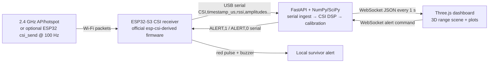

# RescueSense architecture



The receiver does only RF acquisition, compact magnitude conversion, and alert I/O. The laptop owns filtering, PCA, spectral estimation, calibration, and the user interface. This keeps the ESP32 Wi-Fi callback short and makes demo-day tuning fast.

## Signal path

1. The ESP32-S3 receives repeatable Wi-Fi packets from a 2.4 GHz router/hotspot or the official `csi_send` example.
2. Firmware filters to the expected BSSID/MAC, copies CSI out of the Wi-Fi callback into a FreeRTOS queue, calculates complex magnitude in a lower-priority task, and emits `CSI,timestamp_us,rssi,amp...` at roughly 100 Hz.
3. The backend drops stray-width/corrupted packets, masks invalid/guard subcarriers, averages to 10 Hz, whitens each carrier by its own noise level, removes residual gain steps, rejects windows with gross body movement, and selects the **most periodic** PCA component across subcarriers.
4. Every one-second hop, a 30-second window is band-passed and analyzed with Welch/FFT. The backend estimates BPM, peak-to-band confidence, presence, and a calibrated estimated proximity with uncertainty.
5. The dashboard consumes one telemetry object per second. It animates a human marker with the estimated respiratory phase and renders alert state, waveform, and spectrum.

## Deliverable tree

```text
rescue-sense/
├── README.md
├── firmware/                         # derived from official esp-csi csi_recv_router/csi_recv
│   ├── CMakeLists.txt
│   ├── sdkconfig.defaults
│   └── main/
│       ├── jatayu_csi.c
│       ├── Kconfig.projbuild
│       └── idf_component.yml
├── backend/
│   ├── app.py                         # Starlette server, serial/simulate ingest, DSP, WebSocket
│   ├── processing.py                  # CSI DSP, scoring, calibration
│   ├── serial_io.py                   # port discovery, wire parsing, reconnect, simulator
│   ├── collect.py                     # labelled recording utility
│   ├── train_presence_model.py        # optional RandomForest trainer
│   ├── tests/                         # regression suite + accuracy sweep
│   ├── requirements.txt
│   └── README.md
├── dashboard/
│   └── index.html                     # no build step; canvas charts
├── tools/
│   ├── setup.ps1                      # prepare the Python environment
│   ├── build-flash.ps1                # build + flash the firmware
│   └── start-demo.ps1                 # run the backend + dashboard
├── docs/
│   ├── architecture.md
│   ├── firmware-setup.md
│   ├── calibration.md
│   ├── demo-script.md
│   └── failure-modes.md
└── tools/
    └── start-demo.ps1
```

## Honest operating boundary

This is a calibrated, single-link **breathing-motion demonstrator**, not a medically validated life detector or an exact through-wall rangefinder. Only label its output as “Breathing detected” and “estimated proximity”; obtain a separate, certified response system for an actual rescue deployment.
