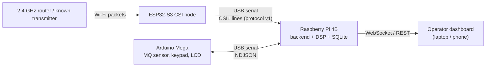

# JATAYU architecture

JATAYU is a stationary, local-first, edge-computing platform for organising RF and
environmental observations in hazardous or inaccessible spaces, with an auditable
human review workflow. It is a decision-support and experimental sensing prototype: it
does not identify survivors, certify an environment as safe, or give exact positions or depth.



## Responsibilities

| Component | Does | Does not |
| --- | --- | --- |
| ESP32-S3 | Capture CSI, gain-compensate, add seq/channel/noise/flags, stream raw over USB, report health | Interpret CSI, store, decide |
| Arduino Mega | Read MQ raw ADC, scan keypad, drive LCD, ack commands | Fusion or decisions |
| Raspberry Pi | Parse/validate both streams, CSI DSP, quality grading, rule-based fusion, SQLite, incidents, API, dashboard | Claim a person is present |

## Signal path (single node)

1. The ESP32-S3 receives packets from a 2.4 GHz router (pinged at ~100 Hz) or a second ESP32 running `csi_send`.
2. Firmware filters to the expected BSSID, copies CSI out of the Wi-Fi callback into a bounded queue, and emits `CSI1,<seq>,<ts>,<rssi>,<noise>,<ch>,<flags>,<amps>` (see [esp32-node.md](esp32-node.md)).
3. The backend drops stray-width/corrupt packets, masks invalid/guard subcarriers, averages to 10 Hz, whitens per subcarrier, removes residual gain steps, rejects gross-movement windows, and picks the most periodic PCA component.
4. Each second a 30 s window is band-passed and scored on rhythm, focus and strength. Packet loss measured from `seq` degrades the data-quality grade.
5. `jatayu/fusion.py` maps this to RF states and a quality grade (below); the gas channel is assessed separately in raw ADC counts.
6. Observations are grouped into incidents; every operator action and device command is an auditable event in SQLite.

## RF states and quality

`NO_DATA`, `COLLECTING`, `INSUFFICIENT_DATA`, `LOW_QUALITY`, `NO_CLEAR_PERIODIC_PATTERN`,
`PERIODIC_PATTERN_OBSERVED`, `REVIEW_RECOMMENDED` (pattern sustained >= 20 s). Data quality
(`none/low/fair/good`) and confidence (`Insufficient data/Low/Moderate/High`) are reported
separately from the pattern state. No state is worded as "person", "survivor" or "breathing detected".

## Incident workflow

Observations (RF pattern, elevated gas reading, operator inspection request, keypad alert request,
operator notes) group into incidents within a 120 s window. Operators can also open an incident
manually, add notes, acknowledge, and close (close requires prior acknowledgement).
Commands to the Mega move created -> sent -> received -> executed -> acknowledged, or failed / timed_out.

## Roadmap alignment (Concept & Architecture Guide)

| Phase | State |
| --- | --- |
| 0-1 Single node on Pi | Backend runs on the Pi 4B with live CSI from the ESP32 (protocol v1) over USB; detection not yet evaluated |
| 2 Environmental I/O | Pi side done (protocol, simulator, API); **Mega firmware not written** |
| 3 Incident workflow | Done: incidents, notes, acknowledgement, event history |
| 4 Multi-node acquisition | Groundwork: node IDs, `nodes` table with deployment metadata, `/api/nodes`. Multi-stream ingestion and time alignment not done |
| 5-6 Spatial research, 3D view | Not started. CSI does not provide reliable distance/angle/depth; this is a research goal |
| 7 Field hardening | Not started |

## Repository layout

```text
firmware/main/jatayu_csi.c      ESP32-S3 CSI node (derived from esp-csi csi_recv_router)
backend/app.py                  Starlette server, CSI ingest, WebSocket
backend/processing.py           CSI DSP, scoring, calibration
backend/serial_io.py            port discovery, CSI1/legacy parsing, sequence tracking, simulator
backend/jatayu/                 protocol, Arduino link, fusion, incidents, SQLite, REST/WS API
backend/capture_raw.py          labelled raw-CSI recorder for experiments
dashboard/index.html            operator console
docs/                           architecture, esp32-node, hardware, firmware-setup, calibration, demo, failure modes
```

## Honest operating boundary

A periodic RF pattern is an observation for operator review, not proof of a living person or breathing.
MQ readings are experimental raw ADC counts, not certified gas concentrations, and are not evidence of a person.
Do not use this system for rescue, triage or life-safety decisions.
